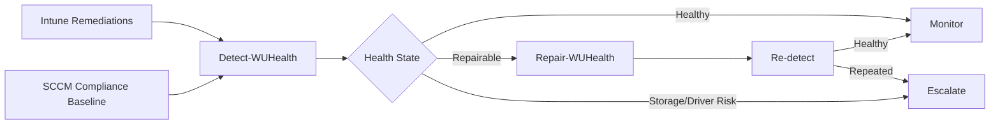

# Windows Update Health Remediation Suite

Automated detection, repair, and escalation of recurring Windows update issues for **Microsoft Intune** and **Microsoft Configuration Manager (SCCM/MECM)**.

> Status: Reference implementation. Always test customer-specific settings in production, sign the scripts, follow the change process, and use pilot groups before broad rollout.

## Objective

The suite does not treat a damaged component store in isolation; it also evaluates storage, file system, driver, firmware, free-space, repeat-failure indicators, and Windows Update health. Critical storage or device issues are intentionally **not automatically repaired** and are escalated for root-cause analysis.

The detection now also checks whether the client has Windows Update problems and whether it is behind the current patch level. It reports the current Windows build/version, UBR, pending updates, service status, update errors, and the last successful patch installation time so that Intune or SCCM can distinguish between a healthy client, a patch-level issue, and an actual Windows Update service fault.

## Architecture

## Directory Structure

- `src/common`: shared health, logging, and repair engine
- `src/intune`: standalone detection and remediation for Intune (generated, common engine embedded)
- `src/sccm`: standalone discovery and remediation for configuration baselines (generated, common engine embedded)
- `build`: `Build-Scripts.ps1` generates the Intune and SCCM scripts from `src/common` and refreshes `manifest.json`
- `src/tools`: local diagnostics and installation helpers
- `config`: configurable thresholds
- `docs`: architecture, rollout, operations, troubleshooting, and support guidance
- `tests`: Pester tests (`tests/Invoke-Tests.ps1` runs them, with or without Pester installed)

## Quick Start

### Intune

1. No separate `config/HealthConfig.json` is required; the Intune scripts ship with embedded defaults and no local repair-source requirement.
2. Upload `src/intune/Detect-WUHealth.ps1` as a detection script.
3. Upload `src/intune/Remediate-WUHealth.ps1` as a remediation script.
4. Run as **SYSTEM** in **64-bit PowerShell** first, without automatic restarts.
5. Use a pilot group and monitor the output in **Devices > Manage devices > Scripts and remediations**.

### SCCM / MECM

1. Create a Windows desktop/server configuration item.
2. Use `src/sccm/Discovery-WUHealth.ps1` as the discovery script with data type `String`.
3. Compliance rule: the return value must be `Healthy`.
4. Store `src/sccm/Remediate-WUHealth.ps1` as the remediation script.
5. Create a configuration baseline, assign it to a pilot collection, and activate automatic remediation only during the maintenance window initially.

## Safety Boundaries

- No automatic `chkdsk /f`, no firmware flashing, no driver replacement, no in-place upgrade.
- No automatic restart caused by Intune remediations.
- Storage events, PnP errors, and repeated corruption are escalated.
- Repairs use the online Windows Update path only; no local DISM source or mounted ISO/media is required.

## Result States

| State | Meaning | Action |
|---|---|---|
| `Healthy` | No relevant findings | Monitor |
| `Repairable` | Component store is repairable or SFC found integrity violations | DISM/SFC (postponed while component servicing waits for a restart) |
| `RebootRequired` | Repair or servicing requires a restart | Maintenance process |
| `PatchLevelBehind` | Build is below the supported baseline or the last patch installation is older than `PatchStaleDays` | Update scan is triggered; installation stays with the update policy |
| `UpdateIssue` | Update installs failed without a later success, the update agent cannot be queried, or the Windows Update service is disabled or missing | Update scan is triggered (optional component reset); then update troubleshooting |
| `EscalateStorage` | Storage/file-system indicators | Hardware/OEM analysis |
| `EscalateDriver` | PnP/critical driver issue | Driver/firmware review |
| `RepeatOffender` | Threshold of repeated repairs reached | Root-cause analysis / rebuild decision |
| `Error` | Validation logic could not be executed completely | Script/client analysis |

### Windows Update checks

The detection queries the local Windows Update agent and captures the following information as part of the health signal set:

- `WindowsUpdate.Status` - overall update health state
- `WindowsUpdate.CurrentBuild` - current OS build
- `WindowsUpdate.CurrentVersion` - OS version
- `WindowsUpdate.UBR` - update build revision
- `WindowsUpdate.PendingUpdates` - number of available but not installed updates
- `WindowsUpdate.ServiceStatus` / `WindowsUpdate.ServiceStartType` - state and start type of the Windows Update service
- `WindowsUpdate.LastScanTime` - time of the local agent query
- `WindowsUpdate.LastInstallationTime` - last patch installation time
- `WindowsUpdate.FailedUpdates` - updates whose installation failed or was aborted and that did not succeed later

The detection reports `PatchLevelBehind` when one of the following is true:

- current build is below the configured minimum supported build (`MinimumSupportedBuild`)
- last patch installation is older than the configured stale threshold (`PatchStaleDays`, default 45)

It reports `UpdateIssue` when one of the following is true:

- an update installation failed or was aborted and the same update has not installed successfully since
- the Windows Update agent cannot be queried
- the Windows Update service is disabled or missing

Deliberately **not** a finding: a stopped Windows Update service (it is a demand-start service), pending updates on their own (update rings defer and schedule them), driver and optional updates.

When several findings apply, the status follows this order: `Error`, `EscalateStorage`, `EscalateDriver`, `RepeatOffender`, `Repairable`, `UpdateIssue`, `PatchLevelBehind`, `RebootRequired`, `Healthy`. Component store corruption ranks above the update states because it is a common cause of them.

### What the remediation does

| Detected state | Remediation action | Intune result |
|---|---|---|
| `Repairable` | `DISM /RestoreHealth` and `sfc /scannow`; postponed while component servicing waits for a restart | Success when the device is `Healthy` or `RebootRequired` afterwards |
| `UpdateIssue`, `PatchLevelBehind` | Triggers a Windows Update scan (`UsoClient StartScan`); renames `SoftwareDistribution` and `catroot2` first only if `ResetWindowsUpdateComponents` is enabled | Success when the scan was triggered |
| Any other state | Nothing (`Blocked`) | Detection does not start remediation for these states |

The remediation never installs updates, restarts the device, clears pending-reboot markers, or changes update policy.

The SCCM scripts turn the Windows Update check off (`CheckWindowsUpdate = $false`) because patch compliance is owned by software updates in Configuration Manager.

This makes the suite useful for both serviceability health and operational patch compliance review.

## Documentation

- [Concept](docs/01-Concept.md)
- [Intune Rollout](docs/02-Intune-Rollout.md)
- [SCCM Rollout](docs/03-SCCM-Rollout.md)
- [Operating Model](docs/04-Operating-Model.md)
- [Troubleshooting](docs/05-Troubleshooting.md)
- [Repair Source](docs/07-Repair-Source.md)
- [In-place Upgrade Escalation](docs/08-Inplace-Upgrade.md)
- [Customization](docs/09-Customization.md)

## Disclaimer

The scripts are a configurable reference implementation. DISM, SFC, Windows Update reset, driver and storage diagnostics must be validated in the target customer environment with security products, maintenance windows, and operational procedures.
