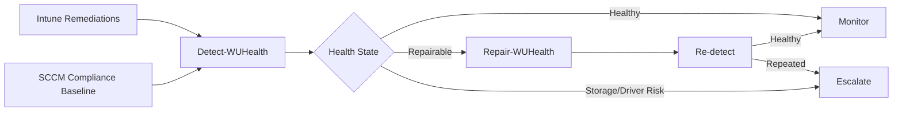

# Windows Update Health Remediation Suite

Automatisierte Erkennung, Reparatur und Eskalation wiederkehrender Windows-Update-Probleme für **Microsoft Intune** und **Microsoft Configuration Manager (SCCM/MECM)**.

> Status: Referenzimplementierung. Vor Produktion immer kundenspezifisch testen, signieren, Change-Prozess durchführen und Pilotgruppen verwenden.

## Ziel

Die Suite behandelt einen beschädigten Component Store nicht isoliert, sondern bewertet zusätzlich Storage-, Dateisystem-, Treiber-, Firmware-, Speicherplatz- und Wiederholungsindikatoren. Kritische Storage- oder Gerätefehler werden bewusst **nicht automatisch repariert**, sondern zur Ursachenanalyse eskaliert.

## Architektur

## Verzeichnisstruktur

- `src/common`: gemeinsame Health-, Logging- und Repair-Engine
- `src/intune`: selbständige Detection und Remediation für Intune (Common Engine eingebettet)
- `src/sccm`: selbständige Discovery und Remediation für Configuration Baselines (Common Engine eingebettet)
- `src/tools`: lokale Diagnose und Installationshelfer
- `config`: anpassbare Schwellenwerte
- `docs`: Architektur, Rollout, Betrieb, Troubleshooting und Sicherheit
- `tests`: Pester-Smoke-Tests

## Schnellstart

### Intune

1. `config/HealthConfig.json` anpassen und den Inhalt bei Bedarf in `src/common/WUHealth.Common.ps1` bzw. die Paketierung integrieren.
2. `src/intune/Detect-WUHealth.ps1` als Detection Script hochladen.
3. `src/intune/Remediate-WUHealth.ps1` als Remediation Script hochladen.
4. Als **SYSTEM**, in **64-Bit PowerShell**, zunächst ohne automatische Neustarts ausführen.
5. Pilotgruppe verwenden und Ausgabe unter **Devices > Manage devices > Scripts and remediations** überwachen.

### SCCM / MECM

1. Configuration Item vom Typ Windows Desktop/Server erstellen.
2. `src/sccm/Discovery-WUHealth.ps1` als Discovery Script, Datentyp `String`.
3. Compliance Rule: Rückgabewert muss `Healthy` sein.
4. `src/sccm/Remediate-WUHealth.ps1` als Remediation Script hinterlegen.
5. Configuration Baseline erstellen, an Pilot-Collection verteilen und automatische Remediation zunächst nur im Wartungsfenster aktivieren.

## Sicherheitsgrenzen

- Kein automatisches `chkdsk /f`, kein Firmware-Flash, kein Treiberaustausch, kein Inplace Upgrade.
- Kein automatischer Neustart durch Intune Remediations.
- Storage-Events, PnP-Fehler und wiederkehrende Korruption werden eskaliert.
- Repair Source muss exakt zu Edition, Architektur, Sprache und Patchstand passen.

## Ergebniszustände

| Zustand | Bedeutung | Aktion |
|---|---|---|
| `Healthy` | Keine relevanten Befunde | Überwachen |
| `Repairable` | Component Store oder Systemdateien auffällig | DISM/SFC |
| `RebootRequired` | Reparatur oder Servicing benötigt Neustart | Wartungsprozess |
| `EscalateStorage` | Storage-/Dateisystemindikatoren | Hardware/OEM-Analyse |
| `EscalateDriver` | PnP-/kritischer Treiberbefund | Treiber-/Firmware-Review |
| `RepeatOffender` | Schwellenwert wiederholter Reparaturen erreicht | Root-Cause-Analyse/Rebuild-Entscheidung |
| `Error` | Prüflogik nicht vollständig ausführbar | Script-/Clientanalyse |

## Dokumentation

- [Konzept](docs/01-Konzept.md)
- [Intune-Rollout](docs/02-Intune-Rollout.md)
- [SCCM-Rollout](docs/03-SCCM-Rollout.md)
- [Betriebsmodell](docs/04-Betriebsmodell.md)
- [Troubleshooting](docs/05-Troubleshooting.md)
- [Security und Governance](docs/06-Security-Governance.md)
- [Repair Source](docs/07-Repair-Source.md)
- [Inplace Upgrade Eskalation](docs/08-Inplace-Upgrade.md)
- [Anpassung](docs/09-Customization.md)

## Disclaimer

Die Skripte sind eine anpassbare Referenz. DISM, SFC, Windows Update Reset, Treiber- und Storage-Diagnosen müssen im jeweiligen Kundennetz, mit Security-Produkten, Wartungsfenstern und Betriebsprozessen validiert werden.
