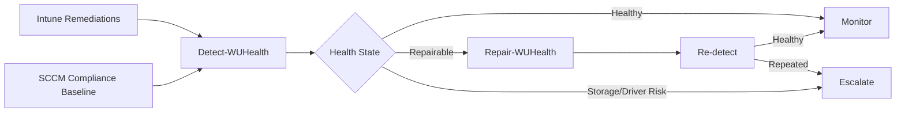

# Windows Update Health Remediation Suite

Automated detection, repair, and escalation of recurring Windows update issues for **Microsoft Intune** and **Microsoft Configuration Manager (SCCM/MECM)**.

> Status: Reference implementation. Always test customer-specific settings in production, sign the scripts, follow the change process, and use pilot groups before broad rollout.

## Objective

The suite does not treat a damaged component store in isolation; it also evaluates storage, file system, driver, firmware, free-space, and repeat-failure indicators. Critical storage or device issues are intentionally **not automatically repaired** and are escalated for root-cause analysis.

## Architecture

## Directory Structure

- `src/common`: shared health, logging, and repair engine
- `src/intune`: standalone detection and remediation for Intune (with common engine embedded)
- `src/sccm`: standalone discovery and remediation for configuration baselines (with common engine embedded)
- `src/tools`: local diagnostics and installation helpers
- `config`: configurable thresholds
- `docs`: architecture, rollout, operations, troubleshooting, and support guidance
- `tests`: Pester smoke tests

## Quick Start

### Intune

1. No separate `config/HealthConfig.json` is required; the Intune scripts ship with embedded defaults and no local repair-source requirement.
2. Upload `src/intune/Detect-WUHealth.ps1` as a detection script.
3. Upload `src/intune/Remediate-WUHealth.ps1` as a remediation script.
4. Run as **SYSTEM** in **64-bit PowerShell** first, without automatic restarts.
5. Use a pilot group and monitor the output in **Devices > Manage devices > Scripts and remediations**.

### SCCM / MECM

1. Create a Windows desktop/server configuration item.
2. Use `src/sccm/Discovery-WUHealth.ps1` as the discovery script with data type `String`.
3. Compliance rule: the return value must be `Healthy`.
4. Store `src/sccm/Remediate-WUHealth.ps1` as the remediation script.
5. Create a configuration baseline, assign it to a pilot collection, and activate automatic remediation only during the maintenance window initially.

## Safety Boundaries

- No automatic `chkdsk /f`, no firmware flashing, no driver replacement, no in-place upgrade.
- No automatic restart caused by Intune remediations.
- Storage events, PnP errors, and repeated corruption are escalated.
- Repairs use the online Windows Update path only; no local DISM source or mounted ISO/media is required.

## Result States

| State | Meaning | Action |
|---|---|---|
| `Healthy` | No relevant findings | Monitor |
| `Repairable` | Component Store or system files are suspicious | DISM/SFC |
| `RebootRequired` | Repair or servicing requires a restart | Maintenance process |
| `EscalateStorage` | Storage/file-system indicators | Hardware/OEM analysis |
| `EscalateDriver` | PnP/critical driver issue | Driver/firmware review |
| `RepeatOffender` | Threshold of repeated repairs reached | Root-cause analysis / rebuild decision |
| `Error` | Validation logic could not be executed completely | Script/client analysis |

## Documentation

- [Concept](docs/01-Concept.md)
- [Intune Rollout](docs/02-Intune-Rollout.md)
- [SCCM Rollout](docs/03-SCCM-Rollout.md)
- [Operating Model](docs/04-Operating-Model.md)
- [Troubleshooting](docs/05-Troubleshooting.md)
- [Repair Source](docs/07-Repair-Source.md)
- [In-place Upgrade Escalation](docs/08-Inplace-Upgrade.md)
- [Customization](docs/09-Customization.md)

## Disclaimer

The scripts are a configurable reference implementation. DISM, SFC, Windows Update reset, driver and storage diagnostics must be validated in the target customer environment with security products, maintenance windows, and operational procedures.
